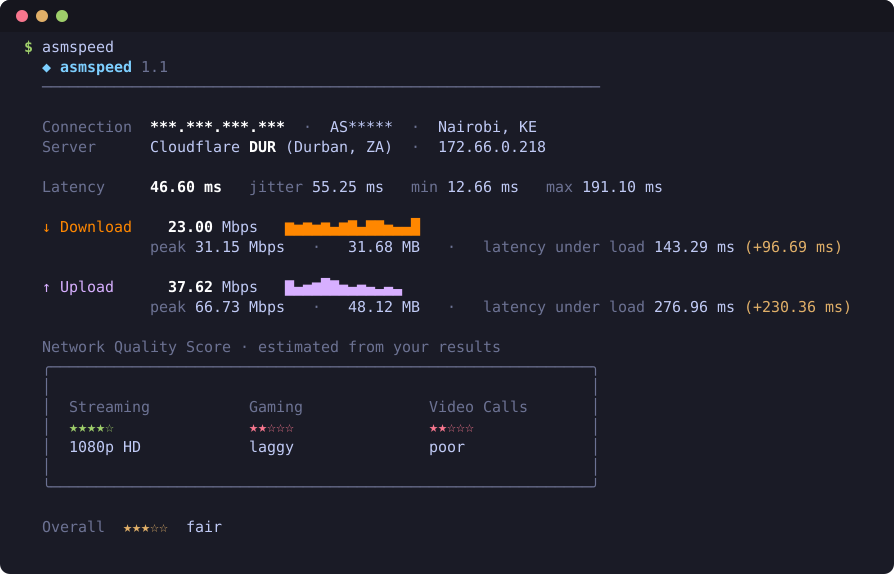
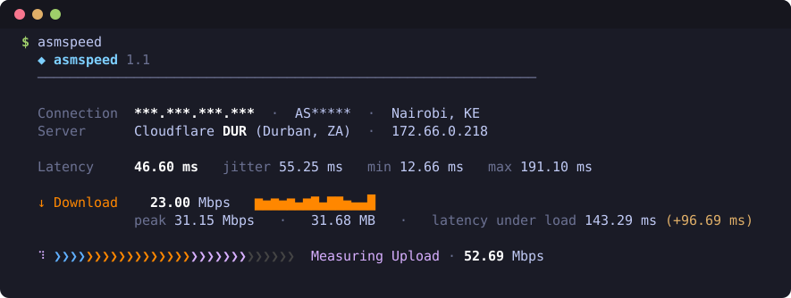

# asmspeed

**A terminal internet speed test written in x86-64 assembly.**
One tiny executable per platform (about 12 KB), no libc, no runtime, no dependencies.



It measures latency, download and upload against Cloudflare's speed servers, shows
a live progress bar while it runs, and finishes with a Network Quality Score for
streaming, gaming and video calls.



*(Screenshots are real runs; the public IP and ASN are masked.)*

## Features

- **Latency** with min, max and jitter, plus **latency under load** per direction
  (the bufferbloat number that explains why calls lag on an otherwise fast link).
- **Download and upload** over several parallel connections, with a live
  chevron progress bar, per-direction sparkline, peak speed and data used.
- **Connection info** from Cloudflare: your IP, ASN and city, and which edge
  location served you.
- **Network Quality Score**: star ratings for Streaming, Gaming and Video Calls.
- Colour and Unicode on a real terminal; clean plain text when piped or with `-n`.
- Linux (raw syscalls, own DNS resolver) and Windows (Winsock) from one shared core.

## Install

Grab the package for your system from the
[latest release](https://github.com/balojr/terminal-speed-test/releases/latest):

| Platform | Package | How |
|---|---|---|
| Fedora / RHEL / openSUSE | `asmspeed-<version>-1.x86_64.rpm` | `sudo rpm -i asmspeed-*.rpm` |
| Debian / Ubuntu | `asmspeed_<version>_amd64.deb` | `sudo dpkg -i asmspeed_*.deb` |
| Any Linux x86-64 | `asmspeed-<version>-linux-x86_64.tar.gz` | extract, then `./install.sh` (root: `/usr/local`, otherwise `~/.local`) |
| Windows 10/11 x64 | `asmspeed-<version>-windows-x64.zip` | extract, double-click `install.bat` (per-user, adds to PATH) |

Uninstall with `./install.sh --uninstall`, `sudo rpm -e asmspeed`,
`sudo dpkg -r asmspeed`, or `uninstall.bat` on Windows.

The Windows `.exe` is unsigned, so SmartScreen or antivirus may warn on first run.

## Usage

```
asmspeed              # latency, download, upload (about 25 seconds)
asmspeed -t 15        # measure each direction for 15 seconds (default 8)
asmspeed -c 8         # 8 parallel connections (default 4)
asmspeed -n           # plain output, no colour (automatic when piped)
```

Exit status: `0` ok, `1` could not reach the server, `2` bad arguments.

## Releases

Latest: **v1.1.0**, the first published release. Downloads are on the
[Releases page](https://github.com/balojr/terminal-speed-test/releases).

| Version | What changed |
|---|---|
| **v1.1.0** | Colour UI with a live chevron progress bar, connection info (IP, ASN, city, edge location), min/max/jitter, latency under load, sparklines, peak speed and data used, Network Quality Score, `-n` flag |
| v1.0.0 | Internal first version (never published): latency, download and upload for Linux and Windows |

## How it measures

- **Latency**: 10 TCP handshakes to the server; average, minimum, maximum and jitter
  (mean difference between consecutive samples).
- **Download / upload**: parallel TCP connections to Cloudflare's `/__down` and
  `/__up` endpoints over plain HTTP. Plain HTTP (no TLS) is what makes a
  pure-assembly client feasible. The first 2 seconds are a warm-up and are not
  counted, which lets TCP ramp up and keeps socket buffers from inflating upload
  numbers. The result is the bytes moved in the following window divided by its
  length, in megabits per second (10^6 bits/s).
- **Latency under load**: a handshake is timed once a second while the link is busy.
- Downloads are requested in 90 MB pieces (Cloudflare stalls requests of 100 MB or
  more); finished connections are reopened automatically.
- Because it is plain HTTP, results can differ from HTTPS-based tools if your
  network shapes or proxies traffic differently by protocol.

### Quality score

Estimates from your own results; the weakest factor wins.

| | 5 stars | 4 | 3 | 2 |
|---|---|---|---|---|
| **Streaming**: download | 25+ Mbps (4K) | 10+ (1080p) | 5+ (720p) | 3+ (SD) |
| **Gaming**: latency / jitter | <30 ms / <10 ms | <60 / <20 | <100 / <40 | <150 / <80 |
| **Video calls**: upload | 5+ Mbps | 3+ | 1.5+ | 0.5+ |
| video calls: latency / jitter | <50 ms / <15 ms | <100 / <30 | <150 / <50 | <250 / <100 |

## Privacy

asmspeed talks only to `speed.cloudflare.com`. The upload payload is zeros.
Your IP, ASN and city are shown on your own screen (they come back in Cloudflare's
response headers); nothing is stored or sent anywhere else.

## Layout

```
src/common.S          platform-independent logic: args, latency, transfers, UI, scores
src/linux.S           Linux layer: raw syscalls + a small UDP DNS resolver
src/windows.S         Windows layer: kernel32 + ws2_32
tools/mkpe.py         builds the Windows PE .exe from GNU as output (no mingw needed)
tools/mkdeb.py        builds the .deb without dpkg
tools/emu_windows.py  runs the .exe under Unicorn with Win32 emulated (test harness)
tools/mkshot.py       renders the README screenshots from a real run, masking IP/ASN
packaging/            man page, install scripts, rpm spec
build.sh              build, test and package everything
```

The two OS layers implement the same small `os_*` interface documented at the top
of `common.S`; everything else is shared.

## Build

Needs GNU binutils (`as`, `ld`, `objcopy`, `nm`) and Python 3. Packaging also
wants `rpmbuild` and `zip`.

```
./build.sh          # build/asmspeed (Linux) and build/asmspeed.exe (Windows)
./build.sh test     # smoke tests
./build.sh dist     # tar.gz, zip, rpm, deb into dist/
```

The Windows build is tested on Linux with an emulator harness
(`pip install unicorn`, then `python3 tools/emu_windows.py build/asmspeed.exe -t 3`).
Reports from real Windows machines are welcome.

## License

MIT, see [LICENSE](LICENSE).
